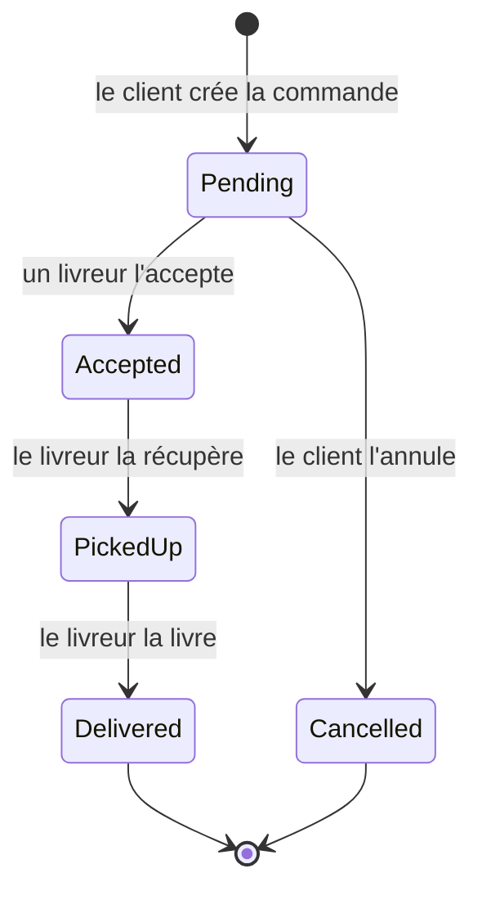

# Delivery API

API REST de gestion de livraisons construite avec ASP.NET Core 10, Entity Framework Core et PostgreSQL.

Les clients passent des commandes, les livreurs les acceptent puis mettent à jour leur statut jusqu'à la livraison. Chaque changement de statut est historisé et les règles métier sont portées par le domaine.

## Fonctionnalités

- Inscription et connexion avec authentification JWT
- Deux rôles : `Customer` (client) et `Courier` (livreur), avec autorisations par rôle
- Création de commandes avec plusieurs articles et calcul automatique du total
- Cycle de vie d'une commande piloté par une machine à états
- Historique complet des changements de statut
- Liste paginée et filtrable des commandes
- Contrôle de concurrence optimiste pour éviter que deux livreurs acceptent la même commande
- Erreurs normalisées au format Problem Details (RFC 9457)
- Documentation OpenAPI interactive avec Scalar
- Health check de la base de données
- Tests unitaires et tests d'intégration sur une vraie base PostgreSQL
- Conteneurisation Docker et intégration continue GitHub Actions

## Stack technique

| Domaine | Technologies |
| --- | --- |
| Langage | C# 14, .NET 10 |
| API | ASP.NET Core (contrôleurs), validation par Data Annotations |
| Base de données | PostgreSQL 17, Entity Framework Core 10, migrations, conventions snake_case |
| Sécurité | JWT Bearer, hachage des mots de passe avec `PasswordHasher` d'ASP.NET Core Identity |
| Documentation | OpenAPI, Scalar |
| Tests | xUnit, `WebApplicationFactory` |
| Outillage | Docker, Docker Compose, GitHub Actions |

## Cycle de vie d'une commande



Toute autre transition est refusée avec une réponse `409 Conflict`. Seul le livreur assigné peut faire avancer une commande qu'il a acceptée.

## Architecture

```
src/DeliveryApi
├── Domain           Entités et règles métier (Order, OrderItem, User, machine à états)
├── Data             DbContext, configurations EF Core et migrations
├── Auth             Options JWT, génération des jetons, rôles, utilisateur courant
├── Services         Cas d'usage (AuthService, OrderService) et erreurs applicatives
├── Contracts        DTO d'entrée et de sortie de l'API
├── Controllers      Endpoints HTTP
└── Infrastructure   Injection de dépendances, gestion globale des erreurs, OpenAPI

tests/DeliveryApi.Tests
├── Domain           Tests unitaires de la machine à états
└── Endpoints        Tests d'intégration HTTP de bout en bout
```

Les entités du domaine protègent leurs invariants : leurs propriétés ne sont modifiables qu'au travers de méthodes métier (`Accept`, `PickUp`, `Deliver`, `Cancel`). Les contrôleurs restent fins et délèguent aux services.

## Modèle de données

| Table | Description |
| --- | --- |
| `users` | Comptes clients et livreurs, email unique |
| `orders` | Commandes, statut, livreur assigné, total |
| `order_items` | Articles d'une commande |
| `order_status_changes` | Historique des changements de statut |

## Endpoints

| Méthode | Route | Rôle | Description |
| --- | --- | --- | --- |
| `POST` | `/api/auth/register` | Public | Créer un compte |
| `POST` | `/api/auth/login` | Public | Se connecter et obtenir un jeton |
| `GET` | `/api/auth/me` | Authentifié | Profil de l'utilisateur connecté |
| `POST` | `/api/orders` | Customer | Créer une commande |
| `GET` | `/api/orders` | Authentifié | Lister ses commandes (`status`, `page`, `pageSize`) |
| `GET` | `/api/orders/available` | Courier | Lister les commandes en attente de livreur |
| `GET` | `/api/orders/{id}` | Authentifié | Détail d'une commande |
| `GET` | `/api/orders/{id}/history` | Authentifié | Historique des statuts |
| `POST` | `/api/orders/{id}/cancel` | Customer | Annuler une commande en attente |
| `POST` | `/api/orders/{id}/accept` | Courier | Accepter une commande |
| `POST` | `/api/orders/{id}/pickup` | Courier | Signaler la récupération |
| `POST` | `/api/orders/{id}/deliver` | Courier | Signaler la livraison |
| `GET` | `/health` | Public | État de l'API et de la base |

## Lancer le projet

Aucun secret n'est versionné : les mots de passe et la clé de signature des jetons sont fournis par des variables d'environnement.

### Avec Docker

```bash
cp .env.example .env
docker compose up --build
```

Renseigner dans `.env` un mot de passe PostgreSQL et une clé de signature aléatoire d'au moins 32 caractères.

L'API est disponible sur `http://localhost:8080` et la documentation interactive sur `http://localhost:8080/scalar`.

### En local

Prérequis : SDK .NET 10 et une instance PostgreSQL accessible sur `localhost:5432`.

```bash
cp .env.example .env
docker compose up -d database
dotnet user-secrets set "ConnectionStrings:Database" "Host=localhost;Port=5432;Database=delivery;Username=postgres;Password=<mot de passe>" --project src/DeliveryApi
dotnet user-secrets set "Jwt:SigningKey" "<clé aléatoire d'au moins 32 caractères>" --project src/DeliveryApi
dotnet run --project src/DeliveryApi
```

Les valeurs sont stockées par `dotnet user-secrets` en dehors du dépôt.

La documentation est disponible sur `http://localhost:5168/scalar`. En environnement de développement, les migrations sont appliquées automatiquement au démarrage.

Pour gérer les migrations manuellement :

```bash
dotnet tool restore
dotnet ef migrations add NomDeLaMigration --project src/DeliveryApi --output-dir Data/Migrations
dotnet ef database update --project src/DeliveryApi
```

## Exemple d'utilisation

```bash
curl -X POST http://localhost:8080/api/auth/register \
  -H "Content-Type: application/json" \
  -d '{"email":"client@example.com","password":"Password123!","fullName":"Jean Dupont","role":"Customer"}'

curl -X POST http://localhost:8080/api/orders \
  -H "Authorization: Bearer <accessToken>" \
  -H "Content-Type: application/json" \
  -d '{"deliveryAddress":"8 place de la Bourse, Bordeaux","items":[{"name":"Pizza","quantity":2,"unitPrice":11.5}]}'
```

## Tests

Les tests d'intégration créent une base PostgreSQL dédiée et éphémère à chaque exécution. La clé de signature des jetons est générée aléatoirement à chaque lancement.

```bash
docker compose up -d database
export TEST_DATABASE_CONNECTION_STRING="Host=localhost;Port=5432;Username=postgres;Password=<mot de passe>"
dotnet test
```

## Configuration

| Clé | Description |
| --- | --- |
| `ConnectionStrings__Database` | Chaîne de connexion PostgreSQL |
| `Database__ApplyMigrationsOnStartup` | Applique les migrations au démarrage |
| `Jwt__SigningKey` | Clé de signature des jetons, 32 caractères minimum, obligatoire |
| `Jwt__Issuer` / `Jwt__Audience` | Émetteur et audience des jetons |
| `Jwt__ExpirationMinutes` | Durée de validité d'un jeton |

## Auteur

Matéo Tillou
